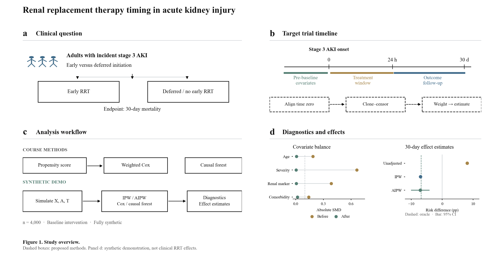
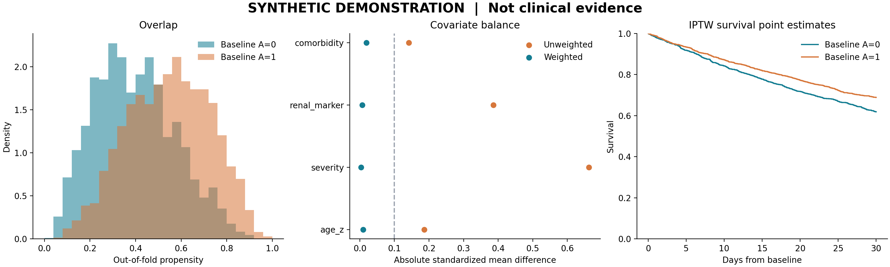

# RRT Timing in Severe AKI

**Target trial design, causal machine learning, and a reproducible synthetic demonstration**

How should an observational study compare early renal replacement therapy (RRT) with delayed or no initiation after stage 3 acute kidney injury (AKI)? This portfolio translates that clinical question into a study protocol, a transparent methods workflow, and executable causal inference examples.

The project builds on a University of Florida Causal AI course project by **Zijian Xu**. The public implementation is newly written and runs exclusively on data generated from mathematical distributions. **No patient records, restricted EHR extracts, original notebooks, fitted clinical models, or clinical study results are distributed.**



## What this project demonstrates

- Translating a treatment-timing question into eligibility rules, time zero, treatment strategies, outcomes, and an estimand.
- Identifying temporal leakage, grace-period assignment problems, confounding by indication, and incomplete outcome ascertainment.
- Estimating propensity scores and checking overlap, standardized mean differences, and effective sample size.
- Comparing inverse probability weighting (IPW), cross-fitted augmented IPW (AIPW), a weighted Cox working model, and an optional causal forest.
- Testing statistical behavior against a known synthetic treatment effect while keeping research data outside the repository.

## Status and scope

| Component | Evidence and status |
| --- | --- |
| Original course project | Report, slides, and archived analysis source were reviewed locally. They support cohort construction, temporal feature preparation, weighted Cox analysis, and CausalForestDML exploration. |
| Complete clinical target trial emulation | **Not established.** Design intent is documented; assignment during the treatment window, sequential weighting, outcome ascertainment, and report/code consistency still need validation. |
| Public executable example | Complete synthetic baseline-treatment analysis. It illustrates estimation and diagnostics, **not a longitudinal emulation of 24-hour or 72-hour RRT strategies**. |
| Clinical conclusions | Not included. Synthetic estimates do not describe patients or support treatment recommendations. |

## Run the example

Use Python 3.9–3.11. The local validation environment used Python 3.9; the CI configuration targets 3.11.

```bash
python -m venv .venv
source .venv/bin/activate
python -m pip install -r requirements.txt
python -m unittest discover -s tests -v
python -m rrt_demo.run --n 4000 --seed 2026 --output demo_output
```

For the optional causal forest:

```bash
python -m pip install -r requirements-forest.txt
python -m rrt_demo.run --n 4000 --seed 2026 --forest --output demo_output
```

Outputs are a machine-readable summary, a covariate-balance table, and diagnostic figures. The program accepts no input dataset and exports no individual records or fitted models. See [reproduction details](docs/reproducibility.md), including the exact scope of uncertainty estimates.

## Read the methods

| Document | Purpose |
| --- | --- |
| [Study protocol](docs/study-protocol.md) | Clinical target trial specification, emulation requirements, and the separate executable toy protocol |
| [Methodology](docs/methodology.md) | Estimands, equations, nuisance estimation, weighting, survival analysis, and causal forest interpretation |
| [End-to-end process](docs/process.md) | Evidence review through synthetic generation, diagnostics, testing, and release |
| [Evidence and TTE audit](docs/evidence-audit.md) | What the original materials establish and what must be reconciled |
| [Privacy and release policy](docs/privacy.md) | Public content boundary, exclusions, and release review |
| [Literature](docs/references.md) | Why the 2022 reference is TSA rather than TTE, and relevant methodological references |

## Synthetic example



The simulation contains measured confounding and heterogeneous effects by construction. Its true risk contrast is available for checking estimator behavior. This is an engineering and statistical demonstration, not a recreation of the original cohort, its distributions, or its findings. [Example output](examples/summary.json) records the seed, model versions, estimates, and diagnostics.

## Repository structure

```text
rrt_demo/       synthetic generator, estimators, timeline checks, runner
tests/          effect recovery, double robustness, balance, temporal checks
docs/           protocol, methods, evidence audit, process, reproducibility
figures/        newly drawn workflow and synthetic diagnostic figures
examples/       aggregate results from the declared synthetic run
scripts/        diagram generation and release-manifest verification
```

## Attribution and limitations

This is a personal educational portfolio, not an institutional release or a validated clinical decision tool. The course project's original source and report remain outside the repository. The public code was independently reconstructed for a synthetic setting and is not a line-by-line release of institutional research software. No redistribution rights to the original research materials are asserted.

The supplied [Xiao et al. 2022 paper](https://doi.org/10.3389/fmed.2022.820624) is a meta-analysis with trial sequential analysis. It motivates the clinical question but is not this project's analytical method. See the [reference comparison](docs/references.md).
